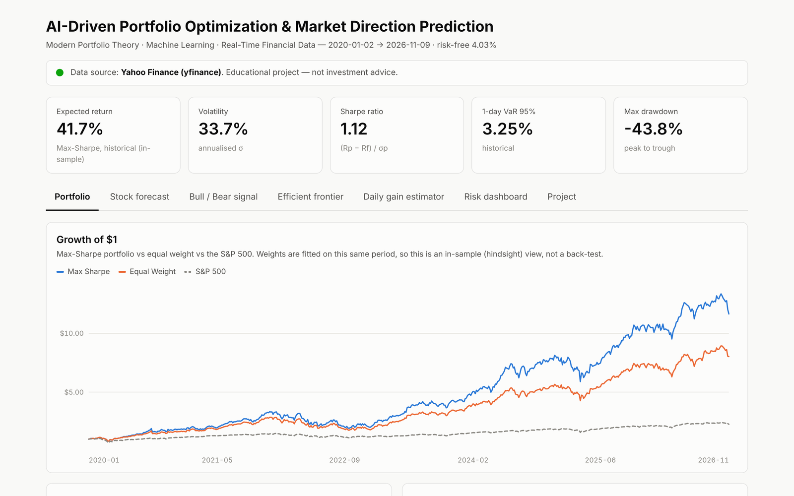
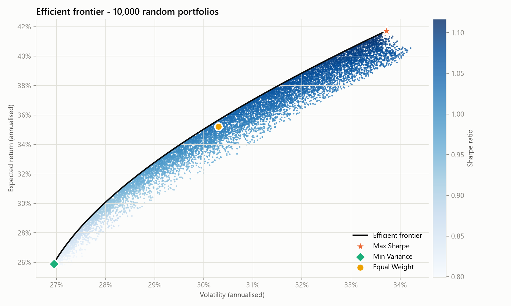
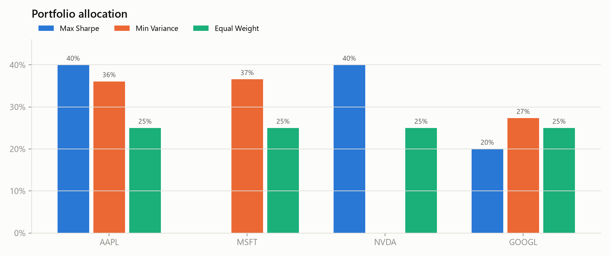
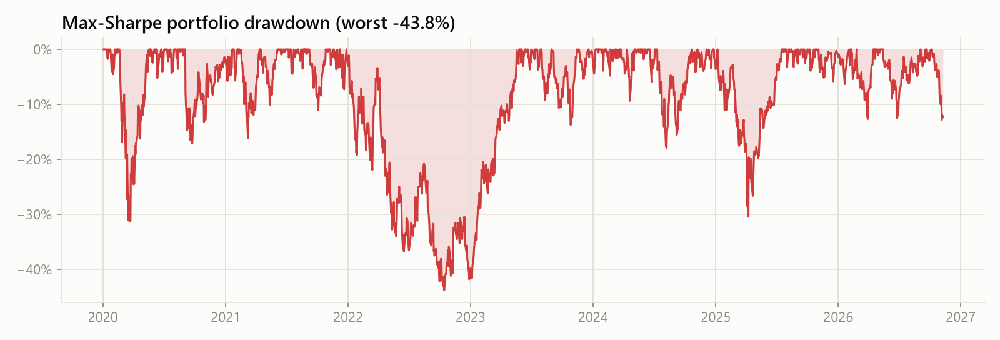
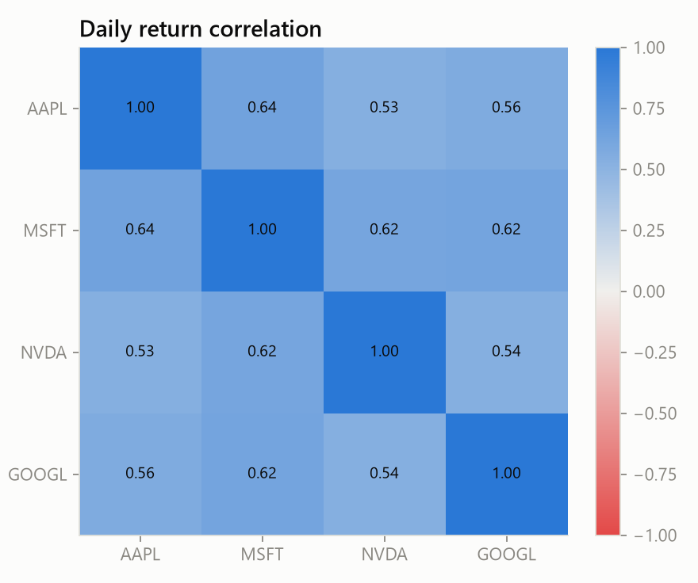
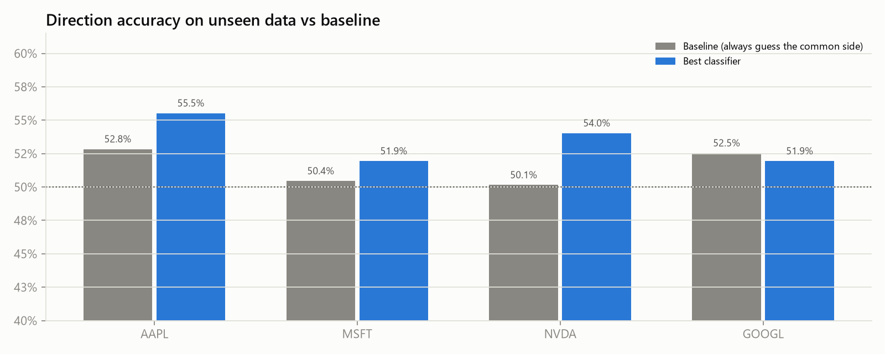
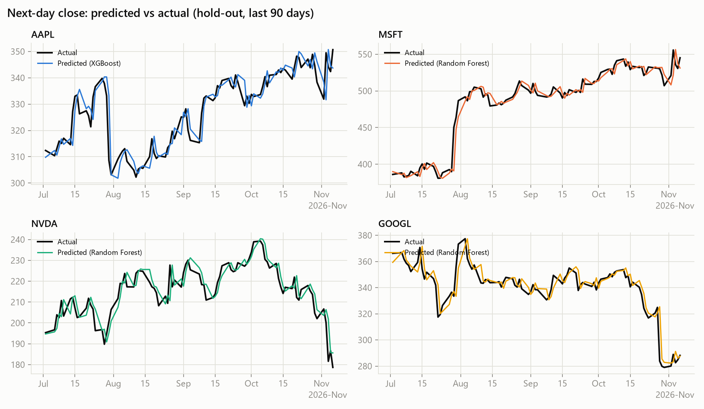
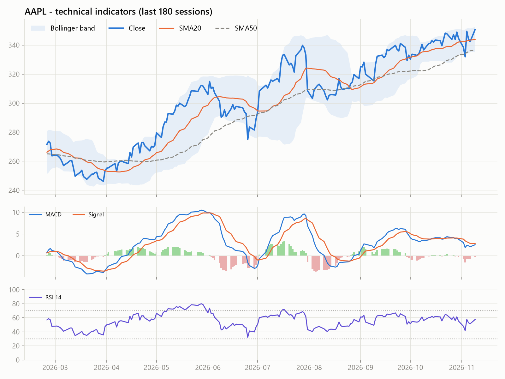
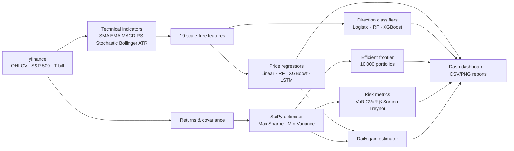

# AI-Driven Portfolio Optimization & Market Direction Prediction

**Modern Portfolio Theory · Machine Learning · Real-Time Financial Data**


This end-to-end Python system:

1. Downloads live market data.
2. Engineers 19 technical features.
3. Forecasts next-day prices with four model families.
4. Classifies the next session as bullish or bearish.
5. Builds Sharpe-optimal portfolios on the efficient frontier.
6. Reports institutional-style risk metrics.

All of it is served through a Dash web dashboard. The models are judged against naive baselines, so the results show what actually works and what doesn't.



> Educational project. Nothing here is investment advice.

---

## Contents

- [Results at a glance](#results-at-a-glance)
- [How it works](#how-it-works)
- [Modules](#modules)
- [Quick start](#quick-start)
- [Methodology](#methodology)
- [Limitations & roadmap](#limitations--roadmap)
- [Project structure](#project-structure)

**Live interactive preview:** https://kwakujunior7.github.io/PortfolioOptimization/preview.html

---

## Results at a glance

**Run details:**

- **Universe:** AAPL, MSFT, NVDA and GOOGL, benchmarked against the S&P 500.
- **Data:** daily prices from **2 Jan 2020 to 9 Nov 2026** (1,723 trading days).
- **Risk-free rate:** 4.03%, from the 13-week T-bill.
- **Constraints:** long-only, maximum 40% in any one stock.

The full output is in [`reports/RESULTS_SUMMARY.md`](reports/RESULTS_SUMMARY.md), and every table is in [`reports/tables/`](reports/tables).

### 1. Portfolio optimisation

| Portfolio | AAPL | MSFT | NVDA | GOOGL | Return | Volatility | Sharpe |
|---|---:|---:|---:|---:|---:|---:|---:|
| **Max Sharpe** | 40.0% | 0.0% | 40.0% | 20.0% | **41.7%** | 33.7% | **1.12** |
| Min Variance | 36.1% | 36.6% | 0.0% | 27.3% | 25.9% | **26.9%** | 0.81 |
| Equal Weight | 25.0% | 25.0% | 25.0% | 25.0% | 35.2% | 30.3% | 1.03 |

These are annualised historical figures. The weights were fitted on the same period they're measured on (see [Limitations](#limitations--roadmap)).

<p>
  
  
</p>

**What the optimiser does:**

- It caps **NVDA** (highest return, 63% a year, but 52% volatility) and **AAPL** at 40% each.
- It drops **MSFT** entirely, because MSFT is the most correlated with the other three (ρ ≈ 0.62–0.64) and adds little diversification.
- Max Sharpe beats equal weight on risk-adjusted return (1.12 vs 1.03), at the cost of higher volatility (33.7% vs 30.3%).
- **The cap is nearly free.** Without it, the optimiser puts 73% in NVDA for a Sharpe of 1.16 at 42.7% volatility. The capped portfolio keeps 97% of that Sharpe with far less single-stock risk.

### 2. Risk profile of the Max-Sharpe portfolio

| Metric | Value | Metric | Value |
|---|---:|---|---:|
| 1-day VaR 95% | 3.25% | Max drawdown | −43.8% |
| 1-day VaR 99% | 5.48% | Beta vs S&P 500 | 1.40 |
| 1-day CVaR 95% | 4.71% | Sortino ratio | 1.67 |
| 1-day CVaR 99% | 7.05% | Treynor ratio | 0.27 |

<p>
  
  
</p>

On 1 day in 20, the portfolio should lose more than 3.25%. On those days the average loss is 4.7%. The 2022 tech sell-off drove the −43.8% maximum drawdown.

### 3. Machine learning: how good are the forecasts?

Models were trained on the first 80% of history and tested on the most recent 20% in time order (335 unseen trading days, 11 Jul 2025 to 6 Nov 2026).

| Ticker | Best direction model | Accuracy | Baseline* | ROC AUC | Beats naive price forecast? |
|---|---|---:|---:|---:|---|
| AAPL | Random Forest | **55.5%** | 52.8% | 0.522 | Barely (XGBoost RMSE $4.41 vs $4.42) |
| MSFT | XGBoost | 51.9% | 50.4% | 0.505 | No |
| NVDA | XGBoost | **54.0%** | 50.1% | **0.565** | Barely (RF RMSE $4.57 vs $4.59) |
| GOOGL | XGBoost | 51.9% | 52.5% | 0.494 | No |

\* The baseline always guesses the more common direction in the test period.



**What the results show:**

- **NVDA and AAPL show a small, plausible edge**: about 3–4 points above the baseline, with an AUC above 0.5.
- **MSFT and GOOGL are statistically indistinguishable from a coin flip.**
- **Next-day price forecasts are almost identical to "tomorrow = today".** That's why the predicted-vs-actual chart below looks impressive: the prediction is mostly yesterday's price.

This matches what the finance literature says about daily returns. Reporting it plainly is the point of the baseline comparisons.



### 4. Next-session signal (snapshot as of 9 Nov 2026)

| Ticker | Signal | Confidence | Last close | Predicted close |
|---|---|---:|---:|---:|
| AAPL | ▲ Bullish | 68.5% | $350.69 | $352.05 |
| MSFT | ▲ Bullish | 51.2% | $545.18 | $544.31 |
| NVDA | ▲ Bullish | 50.5% | $178.67 | $180.45 |
| GOOGL | ▲ Bullish | 57.9% | $288.15 | $290.03 |

Signals expire after one session; re-run `python run.py` for fresh ones. The direction model (classifier) and the price model (regressor) are trained separately, so they can disagree. MSFT is an example: bullish signal, slightly lower predicted close.

### 5. Speculative daily gain estimate

This estimate takes the model forecasts, weights them by the Max-Sharpe allocation, and scales them by capital:

| Capital | Predicted gain | Likely range (±1 sd) | 1-day VaR 95% |
|---:|---:|---:|---:|
| $10,000 | +$68.53 | −$71 to +$209 | −$325 |
| $50,000 | +$342.67 | −$357 to +$1,043 | −$1,627 |
| $100,000 | +$685.34 | −$714 to +$2,085 | −$3,254 |

The range is wider than the estimate itself, so the point forecast is a rough guide, not an expected profit.

### 6. Classic strategy check: MA10/MA50 crossover

This part refactors the original *Build a simple trading strategy* notebook. Each strategy holds 1 share at a time.

| Ticker | Strategy P&L | Buy & hold P&L | Time in market |
|---|---:|---:|---:|
| AAPL | $152.47 | $283.64 | 62% |
| MSFT | $195.71 | $394.92 | 62% |
| NVDA | $100.24 | $172.69 | 67% |
| GOOGL | $209.95 | $228.01 | 66% |

The crossover rule **underperformed buy-and-hold on all four stocks**. In strong bull markets, sitting in cash 35–40% of the time costs more than the drawdowns it avoids.



---

## How it works



## Modules

| # | Module | File | What it does |
|---|--------|------|--------------|
| 1 | Data acquisition | `src/data_loader.py` | OHLCV via `yfinance` with retries, S&P 500 (`^GSPC`) benchmark, 13-week T-bill (`^IRX`) risk-free rate |
| 2 | Technical indicators | `src/indicators.py` | SMA, EMA, MACD, Wilder RSI, Stochastic, Bollinger Bands, ATR |
| 3 | Price prediction | `src/forecast.py`, `src/lstm_model.py` | Next-day open and close: Linear Regression, Random Forest, XGBoost, optional LSTM |
| 4 | Bull/bear detection | `src/forecast.py` | `P(Close[t+1] > Close[t])` with a confidence score |
| 5 | Modern Portfolio Theory | `src/optimizer.py` | $R_p=\sum w_iR_i$, $\sigma_p=\sqrt{w^T\Sigma w}$, $\text{Sharpe}=(R_p-R_f)/\sigma_p$ |
| 6 | Optimisation | `src/optimizer.py` | SciPy SLSQP: max Sharpe and min variance, long-only, weight cap |
| 7 | Efficient frontier | `src/optimizer.py` | 10,000 Monte-Carlo portfolios (same cap) plus the exact frontier |
| 8 | Daily gain estimator | `src/gain_estimator.py` | Capital × predicted return, with a ±1 sd band and VaR |
| 9 | Risk metrics | `src/risk.py` | Historical and parametric VaR, CVaR, max drawdown, beta, Sharpe, Sortino, Treynor |
| 10 | Dashboard | `dashboard/app.py` | Dash/Plotly app: portfolio, forecast, signals, frontier, gain estimator, risk |
| – | Reporting | `src/report.py` | CSV tables, README charts, results summary, saved models |
| – | Back-test | `src/strategy.py` | MA-crossover strategy from the original notebook |

## Quick start

### VS Code (Windows)

1. **File → Open Folder →** `PortfolioOptimization`.
2. Run `.\setup.bat` once. It creates `.venv` and installs the requirements.
3. **Ctrl+Shift+P → Python: Select Interpreter → `.venv`**.
4. Press **F5 → "1. Run full pipeline (live data)"**. It takes about 1–2 minutes.
5. Press **F5 → "4. Launch dashboard"**, then open http://127.0.0.1:8050.

### Command line

```bash
git clone https://github.com/KwakuJunior7/PortfolioOptimization.git
cd PortfolioOptimization
python -m venv .venv
.venv\Scripts\activate            # macOS/Linux: source .venv/bin/activate
pip install -r requirements.txt

python run.py                     # full pipeline -> reports/, docs/images/, models/
python dashboard/app.py           # interactive dashboard
pytest -q                         # 11 tests
```

| Option | Effect |
|---|---|
| `--tickers AAPL MSFT NVDA GOOGL AMZN META` | Any Yahoo Finance tickers |
| `--max-weight 1.0` | Unconstrained MPT (no 40% cap) |
| `--lstm` | Also train LSTMs (`pip install tensorflow`, Python ≤ 3.12) |
| `--offline` | Synthetic sample data, no internet needed |
| `--csv data/historical_prices.csv` | Re-use a saved download |

### What a run produces

| Output | Contents |
|---|---|
| `reports/RESULTS_SUMMARY.md` | Every headline number in one file |
| `reports/tables/*.csv` | Weights, signals, model metrics, risk, gains, correlation, back-test |
| `docs/images/*.png` | The charts in this README |
| `docs/preview.html` | Self-contained interactive dashboard snapshot |
| `models/*.joblib` | Fitted models per ticker |

## Methodology

- **No look-ahead in the ML.** Features at day *t* use only information available at the close of *t*. Train/test splits are chronological and never shuffled.
- **Scale-free features.** The models learn next-day *returns* from returns, ratios and oscillators, then convert the predictions back to prices. This keeps a 2020-trained model valid at 2026 price levels.
- **Honest baselines.** Every price model is compared with *tomorrow = today*, and every classifier with the majority class.
- **Model selection.** Per ticker, the regressor with the lowest hold-out RMSE and the classifier with the highest hold-out ROC AUC are refitted on all data to produce the live signal.
- **Diversification constraint.** Unconstrained max-Sharpe on this universe puts 73% into NVDA. A 40% cap keeps the portfolio investable for almost no loss of Sharpe (1.12 vs 1.16).
- **Risk.** VaR and CVaR are historical 1-day figures. Parametric (Gaussian) VaR is reported alongside for comparison.

## Limitations & roadmap

Being upfront about these is part of doing quant work properly:

- **In-sample optimisation.** The weights are fitted and evaluated on the same 2020–2026 window, so the 41.7% return is hindsight, not a forecast. → *Roadmap: walk-forward back-test (re-optimise quarterly on a trailing window).*
- **Selection bias.** All four stocks were chosen because they're well-known winners, which flatters every portfolio result.
- **Small ML edge.** Gains over the baselines are a few percentage points on 335 test days, within the range of chance for MSFT and GOOGL. The model with the best hold-out score is picked, which inflates that score slightly. → *Roadmap: walk-forward cross-validation and significance tests.*
- **Uncalibrated confidence.** Classifier probabilities (such as AAPL's 68.5%) aren't calibrated. → *Roadmap: Platt or isotonic calibration.*
- **No trading costs or slippage** in the back-test or the gain estimator.

## Project structure

```
PortfolioOptimization/
├── run.py                    full pipeline (F5 in VS Code)
├── config.py                 tickers, dates, risk-free fallback, weight cap
├── setup.bat / setup.sh      one-time environment setup
├── requirements.txt
├── .vscode/                  launch configs, tasks, settings
├── src/
│   ├── data_loader.py   indicators.py   features.py
│   ├── forecast.py      lstm_model.py   optimizer.py
│   ├── risk.py          gain_estimator.py   strategy.py
│   ├── pipeline.py      orchestrates modules 1-9
│   └── report.py        CSVs, charts, summary, saved models
├── dashboard/            Dash app + stylesheet
├── notebooks/            01 MA crossover · 02 data · 03 forecasting · 04 portfolio
├── reports/              RESULTS_SUMMARY.md + tables/*.csv
├── docs/                 preview.html + images/
├── scripts/              build_preview.py
├── tests/                pytest suite
├── data/                 downloaded prices (git-ignored)
└── models/               fitted models (git-ignored)
```

## Tech stack

Python · pandas · NumPy · SciPy · scikit-learn · XGBoost · TensorFlow/Keras (optional) · yfinance · Plotly · Dash · Matplotlib · pytest

## Skills demonstrated

Quantitative finance · Modern Portfolio Theory · risk management (VaR/CVaR) · machine learning · time-series forecasting · model evaluation against baselines · data visualisation · dashboard development · modular, tested Python

## License

[MIT](LICENSE)
